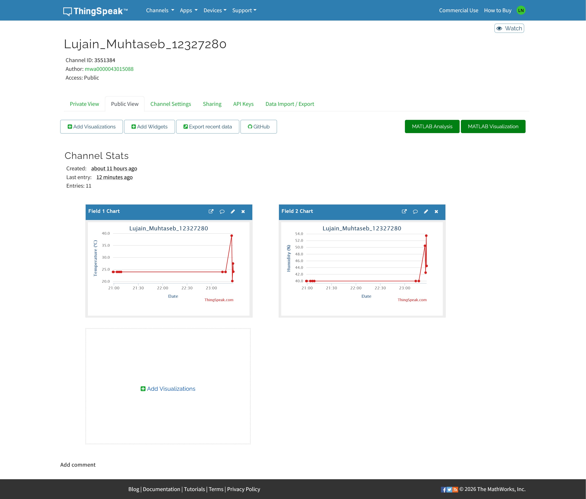
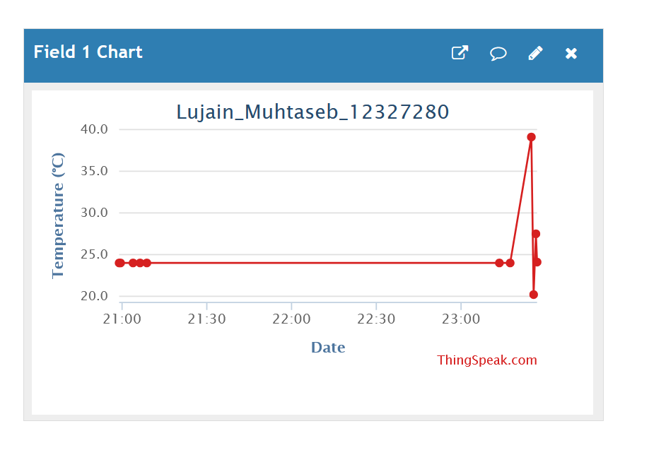
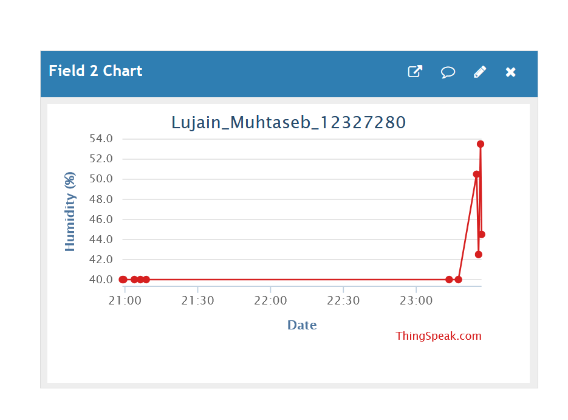

# ESP32 Temperature and Humidity Monitoring

## Project Description
This project uses an ESP32 microcontroller and a DHT22 sensor to measure temperature and humidity. The readings are sent to ThingSpeak over Wi-Fi and displayed using cloud charts.

## Hardware and Tools
- ESP32
- DHT22 temperature and humidity sensor
- Wokwi ESP32 simulator
- ThingSpeak IoT platform
- Arduino C++

## Wiring
- DHT22 VCC → ESP32 3V3
- DHT22 GND → ESP32 GND
- DHT22 DATA → ESP32 GPIO 15

## ThingSpeak Fields
- Field 1: Temperature (°C)
- Field 2: Humidity (%)

The ESP32 sends readings every 20 seconds.

## Project Links
- ThingSpeak Public Channel: https://thingspeak.mathworks.com/channels/3551384
- Wokwi Simulation: https://wokwi.com/projects/478979835100264449

## Student Information
- Full Name: Lujain Muhtaseb
- University ID: 12327280

## Screenshots
### ThingSpeak Dashboard

### Temperature Chart

### Humidity Chart

### wokwi simulator 
![wokwi] (wokwi.png)

## How to Run
1. Open the Wokwi simulation.
2. Add the required DHTesp and ThingSpeak libraries.
3. Configure the ThingSpeak channel number and write API key in the code.
4. Run the simulation and verify that temperature and humidity readings appear in ThingSpeak.

 --  API key removed for security purpose
